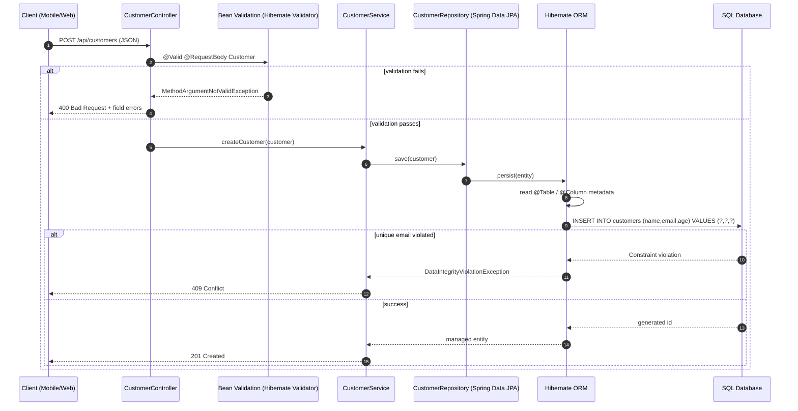
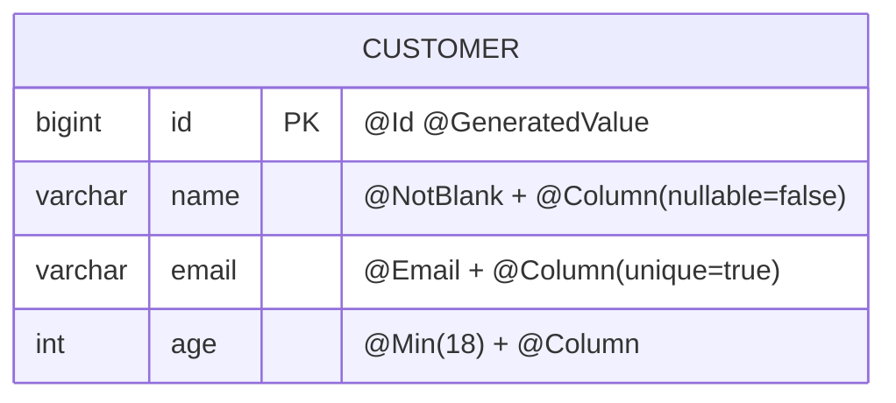
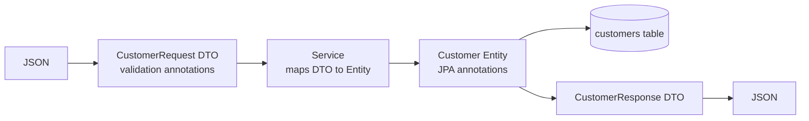

# Spring Boot Main Class: Line-by-Line Internals

```java
@SpringBootApplication
@RequiredArgsConstructor
@EnableConfigurationProperties(JwtProperties.class)
public class BhandarOrbitApplication {

    public static void main(String[] args) {
        SpringApplication.run(
            BhandarOrbitApplication.class,
            args
        );
    }
}
```

---

## 1. `@SpringBootApplication`

A **meta-annotation**, shorthand for three annotations:

| Annotation | What it does |
|---|---|
| `@SpringBootConfiguration` | A specialized `@Configuration`. Marks this class as a source of bean definitions. |
| `@EnableAutoConfiguration` | Tells Spring Boot to configure beans automatically based on what is on the classpath. |
| `@ComponentScan` | Scans this class's package and all sub-packages for `@Component`, `@Service`, `@Repository`, `@Controller`, `@RestController` and `@Configuration` classes. |

### Internals

**Component scan**
- The base package is the package of `BhandarOrbitApplication`.
- A `@Service` outside that package tree will not be found. This is why the main class normally sits in the root package.

**Auto-configuration**
- Boot reads a list of candidate config classes from `META-INF/spring/org.springframework.boot.autoconfigure.AutoConfiguration.imports` inside the Boot jars.
- Each candidate is guarded by conditions:
    - `@ConditionalOnClass`: is Tomcat or Hibernate on the classpath?
    - `@ConditionalOnMissingBean`: did the developer already define one?
    - `@ConditionalOnProperty`: is a property set?
- If `spring-boot-starter-web` is present, you get `DispatcherServlet`, embedded Tomcat and Jackson.
- If `spring-boot-starter-data-jpa` is present, you get `DataSource`, `EntityManagerFactory` and so on.
- Your own beans always win because of `@ConditionalOnMissingBean`.

---

## 2. `@RequiredArgsConstructor`

This is **Lombok**, not Spring. At compile time, Lombok's annotation processor modifies the class bytecode and generates a constructor for all `final` fields and `@NonNull` fields.

It is normally used on `@Service` or `@Controller` classes for constructor injection.

> **On this main class it does nothing useful.** There are no `final` fields, so it only generates an empty constructor. It can be safely deleted along with the Lombok import.

---

## 3. `@EnableConfigurationProperties(JwtProperties.class)`

Internally it does two things:

1. It `@Import`s `EnableConfigurationPropertiesRegistrar`, which **registers `JwtProperties` as a Spring bean**.
2. It activates `ConfigurationPropertiesBindingPostProcessor`, which binds values from `application.yml`, `application.properties`, environment variables or command-line args onto that bean's fields.

Example `JwtProperties`:

```java
@ConfigurationProperties(prefix = "jwt")
public class JwtProperties {
    private String secret;
    private long expirationMs;
    // getters/setters (or a record with constructor binding)
}
```

With this config:

```properties
jwt.secret=abc
jwt.expiration-ms=3600000
```

the values are bound automatically. Relaxed binding maps `expiration-ms` to `expirationMs`. You can then inject `JwtProperties` anywhere.

> **Gotcha:** do not also annotate `JwtProperties` with `@Component`. It would be registered twice. Alternatively, `@ConfigurationPropertiesScan` can register all such classes automatically.

---

## 4. `public class BhandarOrbitApplication`

A plain Java class. Its roles are:
- To hold the annotations above (it becomes the *primary source* of configuration).
- To hold `main`.

---

## 5. `public static void main(String[] args)`

The standard JVM entry point. When you run `java -jar app.jar`, the JVM calls this method.

`args` carries command-line arguments such as `--server.port=9090`, which Spring turns into properties.

---

## 6. `SpringApplication.run(BhandarOrbitApplication.class, args)`

This is where all the work happens, in order:

1. **Create a `SpringApplication`** with your class as the primary source.
2. **Deduce the application type** from the classpath: Servlet (Spring MVC), Reactive (WebFlux) or None.
3. **Load factories and listeners:** `ApplicationContextInitializer`s and `ApplicationListener`s are read from `META-INF/spring.factories`.
4. **Prepare the `Environment`:** merge property sources in priority order (command-line args, env vars, `application.yml`, defaults) and activate profiles.
5. **Print the banner** (the Spring ASCII art).
6. **Create the `ApplicationContext`.** For a servlet app this is `AnnotationConfigServletWebServerApplicationContext`.
7. **Prepare the context:** register your main class as a bean definition and apply the initializers.
8. **`refresh()`**, the heart of Spring:
    - `ConfigurationClassPostProcessor` parses your annotations, runs the component scan, processes `@Import`s and loads the auto-configuration candidates. This is where sections 1 and 3 above actually take effect.
    - `BeanPostProcessor`s are registered (they handle `@Autowired`, `@Transactional`, AOP proxies and so on).
    - **`onRefresh()` creates the embedded web server** (Tomcat by default).
    - All singleton beans are instantiated, with dependencies injected and lifecycle callbacks like `@PostConstruct` run.
    - **`finishRefresh()` starts Tomcat**, which begins listening on the port.
9. **Call runners:** any `CommandLineRunner` or `ApplicationRunner` beans execute.
10. **Publish `ApplicationReadyEvent`.** The app is now live and `run()` returns the `ConfigurableApplicationContext`.

---

## Summary Flow

```
main() -> SpringApplication.run()
   -> build Environment (props/profiles)
   -> create ApplicationContext
   -> scan + auto-configure + register beans (refresh)
   -> instantiate & wire beans
   -> start embedded Tomcat
   -> run runners -> app ready
```

---

## Interview Quick Answers

- **What does `@SpringBootApplication` combine?** `@SpringBootConfiguration` + `@EnableAutoConfiguration` + `@ComponentScan`.
- **How does auto-configuration decide what to create?** Conditional annotations evaluated against the classpath, existing beans and properties.
- **Why must the main class be in the root package?** `@ComponentScan` defaults to the main class's package and its sub-packages.
- **Where is the embedded server created and started?** Created in `onRefresh()`, started in `finishRefresh()`.
- **Why `@EnableConfigurationProperties` instead of `@Component` on the properties class?** It registers the class as a bean and enables binding without double registration.
# Internal Call Flow of `SpringApplication.run()`

This is the Spring Boot 3.x call sequence, starting from:

```java
SpringApplication.run(BhandarOrbitApplication.class, args);
```

---

## Phase 1: Static `run()` and Constructor

```
SpringApplication.run(BhandarOrbitApplication.class, args)
 └─ new SpringApplication(primarySources).run(args)

    new SpringApplication(...)
     ├─ WebApplicationType.deduceFromClasspath()       // SERVLET / REACTIVE / NONE
     ├─ load BootstrapRegistryInitializers             // from spring.factories
     ├─ load ApplicationContextInitializers            // from spring.factories
     ├─ load ApplicationListeners                      // from spring.factories
     └─ deduceMainApplicationClass()                   // walks the stack trace for main()
```

---

## Phase 2: Instance `run(args)`

```
run(args)
 ├─ createBootstrapContext()
 ├─ getRunListeners(args)                  // EventPublishingRunListener
 ├─ listeners.starting()                   // ApplicationStartingEvent
 ├─ prepareEnvironment()
 │    ├─ getOrCreateEnvironment()          // ApplicationServletEnvironment
 │    ├─ configureEnvironment()            // args + profiles
 │    ├─ listeners.environmentPrepared()   // ApplicationEnvironmentPreparedEvent
 │    │    └─ EnvironmentPostProcessorApplicationListener
 │    │         └─ ConfigDataEnvironmentPostProcessor   // loads application.yml/.properties
 │    └─ bindToSpringApplication()
 ├─ printBanner()
 ├─ createApplicationContext()             // AnnotationConfigServletWebServerApplicationContext
 ├─ prepareContext()
 │    ├─ context.setEnvironment()
 │    ├─ applyInitializers()               // ApplicationContextInitializers run
 │    ├─ listeners.contextPrepared()
 │    ├─ load()                            // BeanDefinitionLoader registers your main class
 │    └─ listeners.contextLoaded()
 ├─ refreshContext()  ──────────────►  context.refresh()   (Phase 3)
 ├─ afterRefresh()
 ├─ listeners.started()                    // ApplicationStartedEvent
 ├─ callRunners()                          // ApplicationRunner, then CommandLineRunner
 └─ listeners.ready()                      // ApplicationReadyEvent, app is live
```

---

## Phase 3: `AbstractApplicationContext.refresh()`

```
refresh()
 ├─ 1.  prepareRefresh()                   // init property sources, validate required props
 ├─ 2.  obtainFreshBeanFactory()           // DefaultListableBeanFactory
 ├─ 3.  prepareBeanFactory()               // classloader, SpEL, Aware processors
 ├─ 4.  postProcessBeanFactory()           // servlet scopes (request/session)
 ├─ 5.  invokeBeanFactoryPostProcessors()  // where most of the magic happens
 │        └─ ConfigurationClassPostProcessor.postProcessBeanDefinitionRegistry()
 │             └─ ConfigurationClassParser.parse()
 │                  ├─ @ComponentScan     → ClassPathBeanDefinitionScanner.doScan()
 │                  ├─ @Import            → EnableConfigurationPropertiesRegistrar
 │                  │                       (registers JwtProperties)
 │                  ├─ @Bean methods      → collected
 │                  └─ AutoConfigurationImportSelector   // deferred, processed LAST
 │                       └─ reads AutoConfiguration.imports
 │                          → filters with @Conditional*
 │             └─ loadBeanDefinitions()    // all definitions registered
 ├─ 6.  registerBeanPostProcessors()       // Autowired, Transactional, AOP, ConfigProps binder
 ├─ 7.  initMessageSource()
 ├─ 8.  initApplicationEventMulticaster()
 ├─ 9.  onRefresh()
 │        └─ createWebServer()
 │             └─ TomcatServletWebServerFactory.getWebServer()   // Tomcat built, not yet serving
 ├─ 10. registerListeners()
 ├─ 11. finishBeanFactoryInitialization()
 │        └─ preInstantiateSingletons()    // see Phase 4
 └─ 12. finishRefresh()
          ├─ publish ContextRefreshedEvent
          └─ WebServerStartStopLifecycle.start()
               └─ webServer.start()         // Tomcat connector begins accepting requests
```

---

## Phase 4: Creating Each Singleton Bean

```
preInstantiateSingletons()
 └─ getBean(name)
     └─ doGetBean()
         └─ createBean()
             └─ doCreateBean()
                 ├─ createBeanInstance()        // constructor injection happens here
                 ├─ populateBean()              // field/setter @Autowired
                 └─ initializeBean()
                      ├─ invokeAwareMethods()
                      ├─ postProcessBeforeInitialization()   // @PostConstruct
                      ├─ afterPropertiesSet() / init-method
                      └─ postProcessAfterInitialization()    // AOP/@Transactional proxies created
```

---

## Key Points

- **Order matters:** component scan and auto-config run in step 5, the web server object is built in step 9, beans are created in step 11, and Tomcat only starts listening in step 12. No request can arrive before all beans are ready.
- **`JwtProperties`** is registered in step 5 (by the `@Import` registrar) and bound to your config by `ConfigurationPropertiesBindingPostProcessor`.
- **Auto-configuration is deferred** so your own `@Bean` definitions are already registered when `@ConditionalOnMissingBean` is evaluated.
- **Proxies** (`@Transactional`, `@Async`, `@Cacheable`) are created in the last stage of bean initialization, so you inject the proxy, not the raw object.

---

## Interview Quick Answers

- **Where does component scanning happen?** In `ConfigurationClassPostProcessor`, during `invokeBeanFactoryPostProcessors()`.
- **When is the embedded server created vs started?** Created in `onRefresh()`, started in `finishRefresh()`.
- **Why is auto-configuration processed last?** `AutoConfigurationImportSelector` is a `DeferredImportSelector`, so user-defined beans take priority.
- **Where does `@PostConstruct` run?** In `postProcessBeforeInitialization()` via `CommonAnnotationBeanPostProcessor`.
- **When do runners execute?** After the context refresh, before `ApplicationReadyEvent`.

# How an Entity Class Talks to a SQL Table (`@Column`, `@NotBlank`, `@Email`, `@Min`)

**Industry example:** Customer onboarding in a banking / fintech app (KYC registration API).

---

## 1. The big idea: two separate sets of annotations

| Concern | Annotations | Package | Who reads them | When |
|---|---|---|---|---|
| **Database mapping** | `@Entity`, `@Table`, `@Id`, `@Column` | `jakarta.persistence` | Hibernate (JPA provider) | While building SQL |
| **Input validation** | `@NotBlank`, `@Email`, `@Min`, `@NotNull`, `@Size` | `jakarta.validation.constraints` | Hibernate Validator | Before the data reaches the DB |

> `@NotBlank`, `@Email` and `@Min` do **not** create SQL columns or constraints by themselves. They are checked in Java. `@Column` is what tells Hibernate how the field maps to a table column.

Hibernate Validator also runs automatically on `persist`/`merge` (JPA pre-persist validation) as a second safety net, and Hibernate can read some of them (like `@NotNull`, `@Size`, `@Min`) to generate DDL if you use `ddl-auto=create/update` (dev only).

---

## 2. The entity

```java
import jakarta.persistence.*;
import jakarta.validation.constraints.*;

@Entity
@Table(name = "customers")
public class Customer {

    @Id
    @GeneratedValue(strategy = GenerationType.IDENTITY)
    private Long id;

    @NotBlank(message = "Name must not be blank")
    @Column(name = "name", nullable = false, length = 100)
    private String name;

    @Email(message = "Invalid email format")
    @NotBlank(message = "Email is required")
    @Column(name = "email", nullable = false, unique = true, length = 150)
    private String email;

    @Min(value = 18, message = "Customer must be at least 18")
    @Column(name = "age")
    private int age;

    // getters and setters (or Lombok @Getter/@Setter)
}
```

### What each annotation really does

| Annotation | Layer | Effect |
|---|---|---|
| `@Entity` | JPA | Marks the class as a persistent entity |
| `@Table(name="customers")` | JPA | Maps to table `customers` |
| `@Column(name="name", nullable=false, length=100)` | JPA | Column name, `NOT NULL`, `VARCHAR(100)` |
| `@Column(unique=true)` | JPA | `UNIQUE` constraint in DDL (real enforcement is in the DB) |
| `@NotBlank` | Validation | Not null, and not empty/whitespace after trim (Strings only) |
| `@Email` | Validation | Must look like a valid email address |
| `@Min(18)` | Validation | Number must be >= 18 |

> **Important:** `nullable=false` in `@Column` is a **DB-level / DDL** rule. `@NotBlank` is a **Java-level** rule that fails earlier with a clean message. Use both: validation gives good errors, DB constraints give hard guarantees.

---

## 3. Mapping: Java to SQL

```sql
CREATE TABLE customers (
    id     BIGINT AUTO_INCREMENT PRIMARY KEY,
    name   VARCHAR(100) NOT NULL,
    email  VARCHAR(150) NOT NULL UNIQUE,
    age    INT
);
```

| Java field | JPA / Validation | SQL column |
|---|---|---|
| `id` | `@Id @GeneratedValue` | `id BIGINT PRIMARY KEY AUTO_INCREMENT` |
| `name` | `@NotBlank` + `@Column(nullable=false, length=100)` | `name VARCHAR(100) NOT NULL` |
| `email` | `@Email` + `@Column(unique=true)` | `email VARCHAR(150) NOT NULL UNIQUE` |
| `age` | `@Min(18)` + `@Column` | `age INT` |

If you omit `@Column(name=...)`, Spring Boot's default naming strategy converts `camelCase` to `snake_case` (e.g. `firstName` becomes `first_name`).

---

## 4. Request lifecycle (diagram)



---

## 5. Layered architecture (diagram)

```mermaid
flowchart LR
    A[Client JSON] --> B[Controller<br/>@Valid]
    B -->|valid| C[Service]
    B -->|invalid| X[400 Bad Request]
    C --> D[Repository<br/>JpaRepository]
    D --> E[Hibernate ORM<br/>reads @Entity @Column]
    E --> F[(SQL Table<br/>customers)]
    F -.->|unique violation| Y[409 Conflict]
```

---

## 6. Entity to table (ER view)



---

## 7. Controller

```java
@RestController
@RequestMapping("/api/customers")
public class CustomerController {

    private final CustomerService service;

    public CustomerController(CustomerService service) {
        this.service = service;
    }

    @PostMapping
    public ResponseEntity<Customer> create(@Valid @RequestBody Customer customer) {
        Customer saved = service.create(customer);
        return ResponseEntity.status(HttpStatus.CREATED).body(saved);
    }
}
```

`@Valid` is the trigger. Without it, `@NotBlank`, `@Email` and `@Min` are **never checked** at the controller layer.

## 8. Service and repository

```java
public interface CustomerRepository extends JpaRepository<Customer, Long> {
    boolean existsByEmail(String email);
}

@Service
public class CustomerService {

    private final CustomerRepository repo;

    public CustomerService(CustomerRepository repo) {
        this.repo = repo;
    }

    public Customer create(Customer c) {
        if (repo.existsByEmail(c.getEmail())) {
            throw new IllegalStateException("Email already registered");
        }
        return repo.save(c);   // Hibernate generates the INSERT
    }
}
```

## 9. SQL that Hibernate generates

Enable in `application.properties`:

```properties
spring.jpa.show-sql=true
spring.jpa.properties.hibernate.format_sql=true
logging.level.org.hibernate.orm.jdbc.bind=trace
```

Console output for a valid request:

```sql
insert into customers (age, email, name) values (?, ?, ?)
-- binding: 25, ravi@bank.com, Ravi Kumar
```

---

## 10. Test scenarios

| Request body | Result | Why |
|---|---|---|
| `{"name":"Ravi","email":"ravi@bank.com","age":25}` | **201 Created** | All checks pass, row inserted |
| `{"name":"  ","email":"ravi@bank.com","age":25}` | **400** `name: Name must not be blank` | `@NotBlank` rejects whitespace |
| `{"name":"Ravi","email":"not-an-email","age":25}` | **400** `email: Invalid email format` | `@Email` fails |
| `{"name":"Ravi","email":"ravi@bank.com","age":16}` | **400** `age: Customer must be at least 18` | `@Min(18)` fails |
| Same email posted twice | **409 Conflict** | DB `UNIQUE` constraint (or `existsByEmail` check) |

## 11. Global error handler (clean JSON errors)

```java
@RestControllerAdvice
public class GlobalExceptionHandler {

    @ExceptionHandler(MethodArgumentNotValidException.class)
    public ResponseEntity<Map<String, String>> handleValidation(MethodArgumentNotValidException ex) {
        Map<String, String> errors = new LinkedHashMap<>();
        ex.getBindingResult().getFieldErrors()
          .forEach(f -> errors.put(f.getField(), f.getDefaultMessage()));
        return ResponseEntity.badRequest().body(errors);
    }

    @ExceptionHandler(DataIntegrityViolationException.class)
    public ResponseEntity<String> handleDuplicate(DataIntegrityViolationException ex) {
        return ResponseEntity.status(HttpStatus.CONFLICT).body("Email already exists");
    }
}
```

Example 400 response:

```json
{
  "name": "Name must not be blank",
  "age": "Customer must be at least 18"
}
```

---

## 12. Industry best practice: do not expose the entity directly

In real projects, the request is bound to a **DTO**, and validation lives there. The entity stays focused on persistence.

```java
public record CustomerRequest(
    @NotBlank String name,
    @Email @NotBlank String email,
    @Min(18) int age
) {}
```

```java
@PostMapping
public ResponseEntity<CustomerResponse> create(@Valid @RequestBody CustomerRequest req) { ... }
```



Why: avoids mass-assignment (client setting `id` or `role`), keeps API contract stable when the table changes, and separates validation rules from persistence rules.

---

## 13. Common mistakes

1. Forgetting `@Valid` on the controller parameter, so validation silently never runs.
2. Using `@NotNull` on a `String` and expecting blank rejection. Use `@NotBlank`.
3. Using `@Min` on a primitive `int` when "missing" should be an error. `int` defaults to `0` (fails `@Min(18)`, but with a misleading message). Use `Integer` with `@NotNull`.
4. Relying on `@Email` alone: it accepts values like `a@b`. Add a `@Pattern` regex if you need stricter rules.
5. Relying on `@Column(unique=true)` without a real DB unique index in production schemas. Manage schema with Flyway/Liquibase, not `ddl-auto=update`.
6. Mixing up `jakarta.*` (Spring Boot 3+) and `javax.*` (Spring Boot 2) imports.
7. Missing dependency: add `spring-boot-starter-validation`.

```xml
<dependency>
    <groupId>org.springframework.boot</groupId>
    <artifactId>spring-boot-starter-validation</artifactId>
</dependency>
```

---

## 14. Interview Q&A

**Q1. Does `@NotBlank` create a NOT NULL column?**
No. It is a Bean Validation annotation checked in Java. Use `@Column(nullable = false)` for the DB constraint (Hibernate may also infer `NOT NULL` for `@NotNull` when generating DDL, but do not depend on it).

**Q2. Difference between `@NotNull`, `@NotEmpty`, `@NotBlank`?**
`@NotNull`: not null. `@NotEmpty`: not null and length > 0. `@NotBlank`: not null and has at least one non-whitespace character (String only).

**Q3. Where does validation happen in the request flow?**
At the controller boundary when `@Valid` (or `@Validated`) is present, before the service is called. Hibernate also runs a pre-persist validation as a fallback.

**Q4. How does Hibernate know which column a field maps to?**
It reads the entity metadata at startup: `@Table` and `@Column` (or the naming strategy defaults), then builds the SQL for `INSERT`, `SELECT`, `UPDATE`, `DELETE`.

**Q5. Which exception is thrown for a failed `@Valid` on `@RequestBody`?**
`MethodArgumentNotValidException`. For `@Validated` on method parameters / path variables it is `ConstraintViolationException`.

**Q6. Why use DTOs instead of validating the entity?**
Prevents over-posting, decouples API from schema, and lets different endpoints (create vs update) have different validation rules.

**Q7. A duplicate email is submitted twice at the same moment. How do you handle it?**
`existsByEmail` check is racy. The DB unique constraint is the real guard; catch `DataIntegrityViolationException` and return 409.

---

## 15. Quick summary

```text
JSON  ->  @Valid (NotBlank/Email/Min)  ->  Service  ->  Repository
      ->  Hibernate reads @Entity/@Table/@Column  ->  INSERT SQL
      ->  DB constraints (NOT NULL/UNIQUE)  ->  201 or 400/409
```

- **Validation annotations** protect your *input*.
- **`@Column` and friends** describe your *table*.
- **DB constraints** are the *last line of defence*.